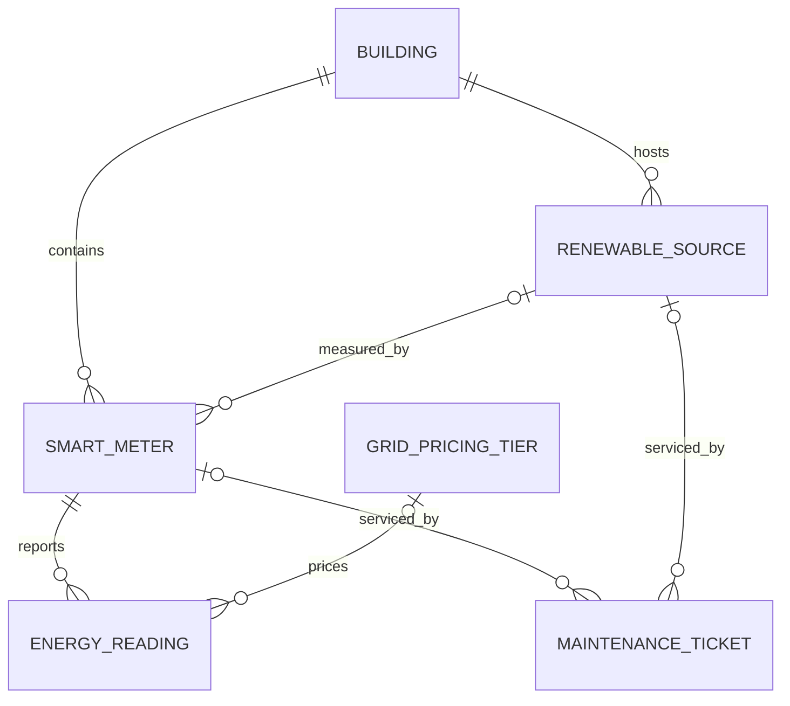

# Smart Campus Micro-Grid Energy Management Database

**Course:** CS 4700/6700 Database Design Project  
**Term:** Fall 2026  
**Student:** Utsav Acharya  
**Due date:** December 4, 2026

> This Markdown document is the report source. Review and personalize the bracketed fields, then export/print it to a single PDF for submission. The companion MySQL script is `smart-campus.sql` in this folder. The sample data and query results below are designed to match that script.

## 1. Problem description

A university uses electricity in academic buildings, a library, and residence halls. Consumption changes during the day, electricity prices may vary by time, and some buildings generate power with solar panels. Campus energy staff need a consistent way to compare building demand, distinguish grid imports from renewable generation, estimate energy costs and emissions, and keep track of equipment maintenance.

This project designs a relational database for a small example campus. It stores buildings, renewable sources, smart meters, timestamped readings, grid pricing periods, and maintenance tickets. It supports reporting on energy consumption, peak demand, renewable generation, estimated grid costs, carbon emissions, and unresolved maintenance.

The sample campus and measurements in this report are fictional and are included to demonstrate the design and SQL. The database is a reporting prototype: it does not control electrical equipment or provide real-time safety monitoring.

## 2. Data storage requirements and constraints

The system stores:

- A unique building ID, building name, location, building type, and floor area.
- Renewable source type, capacity, installation date, and host building.
- Meter type, installation date, host building, and (for generation meters) its renewable source.
- Energy in kWh measured at a timestamp, with the meter that reported it and an optional pricing tier.
- Pricing tier name, daily start/end time, price per kWh, and estimated grid carbon kg per kWh.
- Maintenance ticket description, report date, status, resolution date, and the equipment being serviced.

Integrity rules:

1. Every meter belongs to exactly one building. A building may have multiple meters.
2. Every energy reading belongs to exactly one meter. Energy must be nonnegative; timestamps are stored as `DATETIME`.
3. A renewable source belongs to exactly one building. A generation meter may reference its source.
4. Pricing tiers have nonnegative rates and emissions factors, and a start time earlier than an end time. The example uses non-overlapping daily periods. The application/data owner must keep those periods non-overlapping; ordinary row-level constraints do not prevent overlap between rows.
5. A reading's pricing tier is optional. When provided, its timestamp must fall within that tier's daily interval. This cross-row/time rule is checked by the reporting query; production applications should validate it on insert as well.
6. Every maintenance ticket refers to exactly one meter or one renewable source, not both. `chk_ticket_one_asset` enforces this rule.
7. Status is limited to `OPEN`, `IN_PROGRESS`, or `CLOSED`. A resolution date is optional until work is completed.
8. The meter type identifies whether readings represent `BUILDING_LOAD`, `GRID_IMPORT`, or `RENEWABLE_GENERATION`. For the sample reports, load, grid-import, and generation meters are distinct. Their readings are interval energy in kWh, not instantaneous kW demand.

## 3. ER design

The following ER diagram uses crow's-foot notation. `||` means exactly one; `o|` means zero or one; `o{` means zero or many.



A maintenance ticket references exactly one asset (a meter or a renewable source); the two optional diagram relationships are mutually exclusive per ticket. One row in `EnergyReading` is one meter's reading for one time interval. The design keeps measurement facts separate from relatively stable building, meter, source, and pricing information.

## 4. Relational schema

- `Building(building_id PK, building_name UNIQUE, location, building_type, floor_area_sq_m)`
- `RenewableSource(source_id PK, building_id FK → Building, source_name, source_type, capacity_kw, installation_date)`
- `SmartMeter(meter_id PK, building_id FK → Building, source_id FK → RenewableSource NULL, meter_name, meter_type, installation_date)`
- `GridPricingTier(pricing_tier_id PK, tier_name, start_time, end_time, price_per_kwh, carbon_kg_per_kwh)`
- `EnergyReading(reading_id PK, meter_id FK → SmartMeter, pricing_tier_id FK → GridPricingTier NULL, reading_timestamp, energy_kwh)`
- `MaintenanceTicket(ticket_id PK, meter_id FK → SmartMeter NULL, source_id FK → RenewableSource NULL, reported_date, description, status, resolved_date)`

The full MySQL 8 DDL, sample inserts, and queries are in `smart-campus.sql`. The schema uses primary keys for row identity, foreign keys for referential integrity, `DECIMAL` for measured quantities and rates, and `DATETIME`/`DATE`/`TIME` for time values.

## 5. Sample relation states

The SQL script inserts three buildings (Library, Science Hall, and Residence Hall), two solar sources, eight meters, three daily pricing tiers, ten energy readings, and two maintenance tickets. The following are selected states after running the setup and seed statements.

### Building

| building_id | building_name | building_type | floor_area_sq_m |
|---:|---|---|---:|
| 1 | Central Library | Library | 12000.00 |
| 2 | Science Hall | Academic | 18000.00 |
| 3 | Residence Hall | Residential | 15000.00 |

### SmartMeter

| meter_id | building_id | source_id | meter_name | meter_type |
|---:|---:|---:|---|---|
| 101 | 1 | NULL | Library load meter | BUILDING_LOAD |
| 102 | 1 | NULL | Library grid meter | GRID_IMPORT |
| 103 | 1 | 1 | Library solar meter | RENEWABLE_GENERATION |
| 201 | 2 | NULL | Science load meter | BUILDING_LOAD |
| 202 | 2 | NULL | Science grid meter | GRID_IMPORT |
| 203 | 2 | 2 | Science solar meter | RENEWABLE_GENERATION |
| 301 | 3 | NULL | Residence load meter | BUILDING_LOAD |
| 302 | 3 | NULL | Residence grid meter | GRID_IMPORT |

### GridPricingTier

| pricing_tier_id | tier_name | start_time | end_time | price_per_kwh | carbon_kg_per_kwh |
|---:|---|---|---|---:|---:|
| 1 | Off-peak | 00:00:00 | 07:00:00 | 0.0800 | 0.4000 |
| 2 | Standard | 07:00:00 | 16:00:00 | 0.1200 | 0.3500 |
| 3 | Peak | 16:00:00 | 23:59:59 | 0.2000 | 0.5000 |

### EnergyReading (selected complete sample state)

| reading_id | meter_id | pricing_tier_id | reading_timestamp | energy_kwh |
|---:|---:|---:|---|---:|
| 1 | 101 | NULL | 2026-11-02 09:00:00 | 120.00 |
| 2 | 102 | 2 | 2026-11-02 09:00:00 | 100.00 |
| 3 | 103 | NULL | 2026-11-02 09:00:00 | 20.00 |
| 4 | 201 | NULL | 2026-11-02 09:00:00 | 180.00 |
| 5 | 202 | 2 | 2026-11-02 09:00:00 | 150.00 |
| 6 | 203 | NULL | 2026-11-02 09:00:00 | 30.00 |
| 7 | 101 | NULL | 2026-11-02 18:00:00 | 140.00 |
| 8 | 102 | 3 | 2026-11-02 18:00:00 | 110.00 |
| 9 | 301 | NULL | 2026-11-02 18:00:00 | 250.00 |
| 10 | 302 | 3 | 2026-11-02 18:00:00 | 200.00 |

## 6. SQL query descriptions, SQL, and outputs

The SQL statements below are included and runnable in `smart-campus.sql`. Outputs assume the sample data above. Currency and carbon figures are estimates based on the fictional sample pricing and emissions factors.

### Query 1 — Total building load by building for November 2, 2026

This joins readings to meters and buildings, filters to load meters and a day, then groups and sums energy.

```sql
SELECT b.building_name, SUM(er.energy_kwh) AS total_load_kwh
FROM EnergyReading AS er
JOIN SmartMeter AS sm ON sm.meter_id = er.meter_id
JOIN Building AS b ON b.building_id = sm.building_id
WHERE sm.meter_type = 'BUILDING_LOAD'
  AND er.reading_timestamp >= '2026-11-02 00:00:00'
  AND er.reading_timestamp <  '2026-11-03 00:00:00'
GROUP BY b.building_id, b.building_name
ORDER BY b.building_id;
```

Expected output:

| building_name | total_load_kwh |
|---|---:|
| Central Library | 260.00 |
| Science Hall | 180.00 |
| Residence Hall | 250.00 |

### Query 2 — Peak recorded load interval per building

This finds the maximum interval kWh recorded by a building-load meter on the selected date. It reports the peak interval reading, not instantaneous power demand.

```sql
SELECT b.building_name, er.reading_timestamp, er.energy_kwh AS peak_interval_kwh
FROM EnergyReading AS er
JOIN SmartMeter AS sm ON sm.meter_id = er.meter_id
JOIN Building AS b ON b.building_id = sm.building_id
WHERE sm.meter_type = 'BUILDING_LOAD'
  AND er.reading_timestamp >= '2026-11-02 00:00:00'
  AND er.reading_timestamp <  '2026-11-03 00:00:00'
  AND er.energy_kwh = (
      SELECT MAX(er2.energy_kwh)
      FROM EnergyReading AS er2
      JOIN SmartMeter AS sm2 ON sm2.meter_id = er2.meter_id
      WHERE sm2.building_id = b.building_id
        AND sm2.meter_type = 'BUILDING_LOAD'
        AND er2.reading_timestamp >= '2026-11-02 00:00:00'
        AND er2.reading_timestamp <  '2026-11-03 00:00:00'
  )
ORDER BY b.building_id;
```

Expected output:

| building_name | reading_timestamp | peak_interval_kwh |
|---|---|---:|
| Central Library | 2026-11-02 18:00:00 | 140.00 |
| Science Hall | 2026-11-02 09:00:00 | 180.00 |
| Residence Hall | 2026-11-02 18:00:00 | 250.00 |

### Query 3 — Estimated grid cost by building and pricing tier

This joins grid-import readings to their pricing tier. The output is energy multiplied by price per kWh.

```sql
SELECT b.building_name, gpt.tier_name,
       SUM(er.energy_kwh) AS imported_kwh,
       SUM(er.energy_kwh * gpt.price_per_kwh) AS estimated_cost
FROM EnergyReading AS er
JOIN SmartMeter AS sm ON sm.meter_id = er.meter_id
JOIN Building AS b ON b.building_id = sm.building_id
JOIN GridPricingTier AS gpt ON gpt.pricing_tier_id = er.pricing_tier_id
WHERE sm.meter_type = 'GRID_IMPORT'
  AND er.reading_timestamp >= '2026-11-02 00:00:00'
  AND er.reading_timestamp <  '2026-11-03 00:00:00'
  AND TIME(er.reading_timestamp) >= gpt.start_time
  AND TIME(er.reading_timestamp) <= gpt.end_time
GROUP BY b.building_id, b.building_name, gpt.pricing_tier_id, gpt.tier_name
ORDER BY b.building_id, gpt.pricing_tier_id;
```

Expected output:

| building_name | tier_name | imported_kwh | estimated_cost |
|---|---|---:|---:|
| Central Library | Standard | 100.00 | 12.000000 |
| Central Library | Peak | 110.00 | 22.000000 |
| Science Hall | Standard | 150.00 | 18.000000 |
| Residence Hall | Peak | 200.00 | 40.000000 |

### Query 4 — Estimated grid carbon emissions by building

The estimate multiplies imported kWh by the pricing tier's sample carbon factor.

```sql
SELECT b.building_name,
       SUM(er.energy_kwh * gpt.carbon_kg_per_kwh) AS estimated_grid_carbon_kg
FROM EnergyReading AS er
JOIN SmartMeter AS sm ON sm.meter_id = er.meter_id
JOIN Building AS b ON b.building_id = sm.building_id
JOIN GridPricingTier AS gpt ON gpt.pricing_tier_id = er.pricing_tier_id
WHERE sm.meter_type = 'GRID_IMPORT'
  AND er.reading_timestamp >= '2026-11-02 00:00:00'
  AND er.reading_timestamp <  '2026-11-03 00:00:00'
  AND TIME(er.reading_timestamp) >= gpt.start_time
  AND TIME(er.reading_timestamp) <= gpt.end_time
GROUP BY b.building_id, b.building_name
ORDER BY b.building_id;
```

Expected output:

| building_name | estimated_grid_carbon_kg |
|---|---:|
| Central Library | 67.000000 |
| Science Hall | 52.500000 |
| Residence Hall | 100.000000 |

### Query 5 — Renewable generation by building and source

```sql
SELECT b.building_name, rs.source_name,
       SUM(er.energy_kwh) AS generated_kwh
FROM EnergyReading AS er
JOIN SmartMeter AS sm ON sm.meter_id = er.meter_id
JOIN RenewableSource AS rs ON rs.source_id = sm.source_id
JOIN Building AS b ON b.building_id = rs.building_id
WHERE sm.meter_type = 'RENEWABLE_GENERATION'
  AND er.reading_timestamp >= '2026-11-02 00:00:00'
  AND er.reading_timestamp <  '2026-11-03 00:00:00'
GROUP BY b.building_id, b.building_name, rs.source_id, rs.source_name
ORDER BY b.building_id;
```

Expected output:

| building_name | source_name | generated_kwh |
|---|---|---:|
| Central Library | Library rooftop solar | 20.00 |
| Science Hall | Science Hall solar | 30.00 |

### Query 6 — Open and in-progress maintenance tickets

```sql
SELECT mt.ticket_id, mt.description, mt.status,
       COALESCE(sm.meter_name, rs.source_name) AS equipment,
       b.building_name
FROM MaintenanceTicket AS mt
LEFT JOIN SmartMeter AS sm ON sm.meter_id = mt.meter_id
LEFT JOIN RenewableSource AS rs ON rs.source_id = mt.source_id
JOIN Building AS b ON b.building_id = COALESCE(sm.building_id, rs.building_id)
WHERE mt.status IN ('OPEN', 'IN_PROGRESS')
ORDER BY mt.reported_date, mt.ticket_id;
```

Expected output:

| ticket_id | description | status | equipment | building_name |
|---:|---|---|---|---|
| 1 | Meter readings intermittently missing | OPEN | Residence grid meter | Residence Hall |

## 7. Data modification examples

The companion script includes examples of `INSERT`, `UPDATE`, and `DELETE` inside a transaction that is rolled back, so they demonstrate the commands without changing the final sample relation states. The setup also demonstrates table creation, constraints, joins, filtering, sorting, grouping, aggregate functions, and a correlated subquery. Run the SQL script in a dedicated project schema and follow its setup note; do not run its table-reset section in a schema containing data you need to keep.

## 8. Discussion

The design separates relatively stable entities from time-series readings. This avoids repeating building, meter, source, and pricing descriptions for every measurement and provides clear foreign-key relationships for multi-table queries. The six relations are sufficient for the required reporting examples and demonstrate one-to-many relationships.

One design choice is that `EnergyReading` stores interval kWh rather than a cumulative meter counter. That makes daily totals straightforward, but the interval length and sensor quality should be documented in a real deployment. A future version could add interval duration, quality flags, source-specific reporting, battery storage, and a data-import log.

Grid pricing and carbon factors are illustrative. The example query uses the tier stored with each grid-import reading and checks that the reading time falls in the tier's daily window. In production, rates may depend on date, season, utility, and contract; an effective-dated rate design would be needed. Similarly, the estimated carbon factor is a simplified assumption, not an official emissions calculation.

The schema's foreign keys and checks protect many important rules. Some rules span multiple rows or tables—such as ensuring pricing periods never overlap or guaranteeing a generation meter references a source in the same building—so a production application would need additional validation, triggers, or carefully designed constraints. Testing with a small dataset makes query results easy to verify, while a production system with frequent readings would need indexing and retention strategies.

**Personalize before submission:** Add your name, confirm your instructor's preferred DBMS and SQL dialect, run `smart-campus.sql` in that DBMS, capture actual output/screenshots, and update this report if the DBMS displays different formatting. Export this report and any required diagram to one PDF file.
